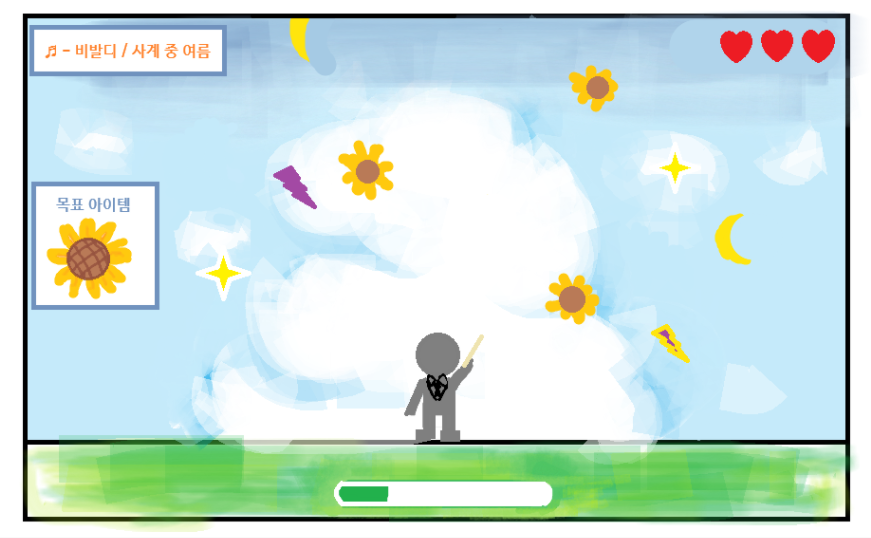

# 게임 기획서: 선율 수집가

## 1. 제목
선율 수집가

## 2. 한 줄 설명
지휘자를 마우스로 움직여 클래식 곡의 조각을 모으고, 선율 게이지를 채워 인간의 모습으로 태어난 곡 ‘무지카’를 만나는 게임

## 3. 플레이어가 하는 일
- 조작: 좌우 방향키로 지휘자를 움직인다. 지휘자는 땅 위에 서 있으며 높이는 고정되고 좌우로만 이동한다.
- 목표: 떨어지는 아이템 중 현재 곡의 목표 파편만 모아 선율 게이지를 채운다. 게이지가 100%가 되면 해당 곡이 인간 형태를 이룬 ‘무지카’를 만난다.

## 4. 화면에 있는 것

| 이름 | 생김새 | 역할 |
|---|---|---|
| 플레이어 | 지휘봉과 연미복을 착용한 지휘자 | 좌우 방향키로 움직이며 곡의 파편을 모은다 |
| 떨어지는 아이템 | 스테이지의 목표 파편과 목표가 아닌 여러 파편 | 곡에 맞는 파편을 모으고 나머지는 피한다 |
| 스테이지 표시 | 화면 상단 가운데의 스테이지 번호 | 현재 진행 중인 스테이지를 보여 준다 |
| 곡 정보 | 화면 왼쪽 위의 음표 아이콘, 작곡가와 클래식 원곡 이름 | 이번 스테이지에서 만날 무지카의 원곡을 알려 준다 |
| 목표 아이템 | 곡 정보 바로 아래의 아이콘 칸 | 이번 스테이지에서 수집해야 할 파편을 보여 준다 |
| 라이프 | 화면 오른쪽 위의 하트 3개 | 목표가 아닌 아이템을 받을 때마다 하나씩 줄어든다 |
| 선율 게이지 | 지휘자 바로 아래의 진행 막대 | 목표 파편을 모을수록 차오르며 100%가 되면 무지카를 만난다 |
| 배경 | 낮·석양·밤·새벽 중 곡의 분위기를 표현한 풍경 | 스테이지 음악의 분위기를 시각적으로 나타낸다 |
| 무지카 | 해당 곡의 분위기와 특징이 인간 형태로 표현된 캐릭터 | 선율 게이지를 모두 채우면 등장하는 만남의 대상 |

## 5. 규칙
- 목표 아이템을 받으면 선율 게이지가 5% 오른다. 게이지는 100%를 넘지 않는다.
- 선율 게이지를 100% 채우면 해당 클래식 곡이 형체를 이룬 무지카를 만난다.
- 목표가 아닌 아이템을 3개 받으면 라이프를 모두 잃고 실패 화면이 나온다.
- 실패 화면의 다시하기 버튼을 누르면 게임이 초기화되고, 2초 뒤 아이템이 화면 위에서 떨어지기 시작한다.
- 지휘자는 땅 위에서 높이가 고정된 채 좌우 방향키로 움직이며 화면 밖으로 나갈 수 없다.
- 아이템은 지휘자가 서 있는 가장 아래쪽 잔디 바닥에 닿으면 사라지고, 지휘자와 충돌하면 목표 아이템은 게이지를 채우며 방해 아이템은 라이프를 줄인다.
- 스테이지마다 클래식 곡과 목표 파편의 모양이 달라진다. 한 스테이지의 목표 아이템 종류는 하나로 정한다.
- 곡의 분위기에 따라 배경 시간대를 낮, 석양, 밤, 새벽 중에서 선택한다.

## 6. 화면 스케치

## 7. 만들 순서
- [x] 1단계: Canvas에 지휘자, 배경, 곡 정보, 목표 아이템, 하트, 선율 게이지를 그린다.
- [x] 2단계: 목표 파편과 방해 파편이 위쪽에서 떨어지도록 만든다.
- [x] 3단계: 좌우 방향키로 지휘자를 움직이고, 화면 밖으로 나가지 않도록 제한한다.
- [x] 4단계: 지휘자와 아이템의 충돌을 판정한다. 목표 파편은 게이지를 5% 올리고, 다른 파편은 라이프를 줄인다.
- [x] 5단계: 게이지 100%일 때와 라이프가 0일 때의 화면 처리를 만든다.
- [ ] 6단계: 첫 스테이지를 완성하고 테스트한 뒤 다른 곡·파편·무지카와 낮·석양·밤·새벽 배경을 추가한다.
- [ ] 마지막 단계: 화면 크기와 난이도를 조정하고 배포 주소에서 전체 진행을 확인한다.
